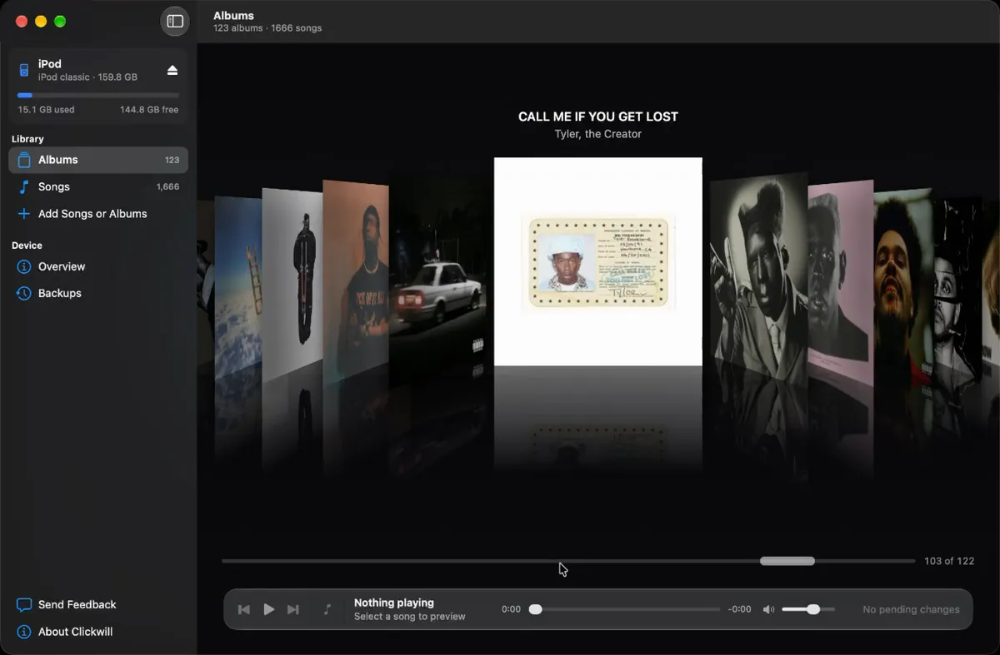

# Clickwill

**An iPod library manager for the Mac, and an alternative to iTunes for the
iPod classic and iPod nano.**

Clickwill manages the music library on an iPod without iTunes or Apple Music.
It reads and writes the iPod's own database (`iTunesDB`) and artwork files
directly on the device, so there is no library to keep in sync on the Mac:
what you see is what is on the iPod.



With Clickwill you can browse the library in Cover Flow, add songs and albums,
change artwork, reorder tracks, fix album metadata, merge duplicates, convert
files the iPod cannot play, rip audio CDs, and restore earlier states of the
library from backups.

**[Download the free beta](https://clickwilldev.com/#download)** &middot;
[clickwilldev.com](https://clickwilldev.com)

## Requirements

- macOS 14 Sonoma or later, on Apple silicon or Intel
- An iPod classic, or an iPod nano (2nd to 4th generation). Older iPods open
  read-only.

Nothing else to install: conversion and CD import use what is already in macOS.

## How it keeps the iPod safe

- Nothing is written until you choose **Write to iPod**.
- Every write starts with a backup of the database and artwork on the Mac.
- Every record goes back to disk as its original bytes, with only the fields
  Clickwill understands changed, so undocumented fields survive.
- The new database is parsed again, signed, written to a temporary file,
  read back from the disk and compared byte for byte before it replaces the old one.
- Writing is allowed only where the iPod's database format and its USB identity
  match. Tested on hardware: the iPod classic and the iPod nano (2nd generation).
  The iPod nano (3rd and 4th generation) can be edited too, without new artwork
  until its formats are confirmed. Other iPods open read-only.

## Repository layout

| Path | What it is |
|------|------------|
| `Sources/ITDBKit` | The core: reading and writing `iTunesDB` and `ArtworkDB`, the hash58 signature, backups. Pure Swift, no third-party dependencies. |
| `Sources/ClickwillModel` | The app's model layer: library state, the change queue, the write transaction, import and CD ripping. No AppKit. |
| `Sources/ipodctl` | A developer command-line tool built on the same core and model. |
| `App` | The SwiftUI Mac app (`App/project.yml` is the XcodeGen project). |
| `Tests` | Swift Testing suites for the core and the model. |
| `Tools` | The check script and the hash58 table tools. |
| `docs/byte-map.md` | What sits under which byte in `iTunesDB` and `ArtworkDB`, with how sure we are of each field. |

## Building

To build from source you also need Xcode 27 (the app target uses Swift 6 with
strict concurrency) and [XcodeGen](https://github.com/yonaskolb/XcodeGen) to
generate the Xcode project.

The tests use Swift Testing, which ships with Xcode rather than the Command
Line Tools, so point the toolchain at Xcode:

```sh
export DEVELOPER_DIR=/Applications/Xcode.app/Contents/Developer
swift build
swift test
```

The Mac app:

```sh
cd App && xcodegen generate && cd ..
xcodebuild -project App/Clickwill.xcodeproj -scheme Clickwill -configuration Debug build
```

Or everything at once - core tests and the Mac build, one line per step:

```sh
Tools/check.sh
```

Debug builds are signed ad hoc and talk to a local server at
`http://localhost:8787` for feedback; release builds use the website.

## ipodctl

A developer tool for checking the core on real hardware. Commands that edit
the library show a preview and write only with `--apply`; `restore` writes
right away (after its own backup of the current state).

```sh
swift run ipodctl info        # volume, GUID, signing scheme, whether writing is allowed
swift run ipodctl hash58      # verify the database signature
swift run ipodctl library     # library summary
swift run ipodctl backup      # back up the database and artwork
swift run ipodctl snapshots   # list backups
swift run ipodctl verify ID   # check a backup's checksums
swift run ipodctl restore ID  # restore a backup to the device
```

Run `swift run ipodctl` without arguments for the full list. Close Apple Music
before writing: when it is open and the iPod is connected, Music can rewrite
the iPod's database.

Backups go to `~/Library/Application Support/Clickwill/Backups/<device>/`.
Files identical to those in older backups are hard-linked, so a new backup
usually costs about as much as the database alone.

## The hash58 signature

The iPod classic and the iPod nano (3rd and 4th generation) check the database
with a `hash58` signature: HMAC-SHA1 over the whole file, with a key derived
from the device's FireWire GUID. Without a valid signature the device rejects
the database.

The Swift implementation in `Sources/ITDBKit/Signing` was written from the
algorithm description in [libgpod](https://github.com/gtkpod/libgpod)
(`src/itdb_hash58.c`, BSD-3-Clause, Copyright (C) 2007 Christophe Fergeau,
based on a proof of concept by wtbw). Its lookup tables were also compared with
[mono/ipod-sharp](https://github.com/mono/ipod-sharp) (`src/Hash58.cs`) as a
correctness check. `Tools/generate-hash58-tables.py` regenerates the tables
from both references and stops if they differ. The full notice is in
[THIRD-PARTY-NOTICES](THIRD-PARTY-NOTICES).

## License

Clickwill is free software: you can redistribute it and/or modify it under the
terms of the GNU General Public License as published by the Free Software
Foundation, version 3. See [LICENSE](LICENSE).

iPod, iPod classic, iTunes, Apple Music, Mac and macOS are trademarks of
Apple Inc. Clickwill is not supported, written or published by Apple.
